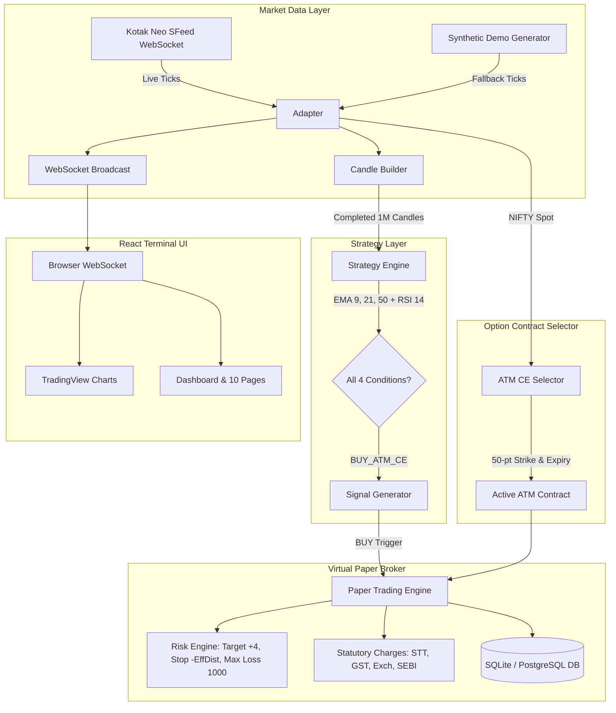

# NEXTRADE — Automated Algorithm & Paper Trading System

A high-performance algorithmic and paper trading web application built for NSE NIFTY index options, integrating the official **Kotak Neo API** (SFeed WebSocket & REST API), a state-based 1-minute trend momentum strategy, an independent virtual execution broker, and interactive TradingView charts.

> [!IMPORTANT]
> **PAPER TRADING ONLY:** NEXTRADE is strictly a paper trading and simulated backtesting environment. Real-money order placement to Kotak Neo is prohibited in software. All orders and positions are executed virtually in an independent paper broker.

---

## 1. System Architecture



---

## 2. Technology Stack

- **Backend**:
  - Python 3.11+
  - FastAPI (REST & WebSockets)
  - SQLAlchemy 2.0 (Async Engine & Session)
  - SQLite with `aiosqlite` (Local Dev) / PostgreSQL & Supabase compatible
  - Pydantic v2 & Pydantic-Settings
  - Official `kotakneoapi` (Kotak Neo Python SDK v3.0+)
  - NumPy & Pandas (Data processing)
  - Pytest & Pytest-Asyncio (Automated Testing Suite)

- **Frontend**:
  - React 18 & TypeScript
  - Vite
  - Tailwind CSS (Dark Trading Terminal Theme)
  - TradingView Lightweight Charts v4
  - Lucide React Icons

---

## 3. Original Trading Strategy Logic (DO NOT MODIFY)

The system implements the original strategy logic without optimizations or extra confirmation filters:

| Parameter | Specification |
| :--- | :--- |
| **Underlying** | NIFTY Index |
| **Instrument** | NIFTY ATM CE Option Contract |
| **Timeframe** | 1 Minute |
| **Indicators** | EMA 9, EMA 21, EMA 50, Wilder's RSI 14 |
| **Condition 1** | $\text{EMA 9} > \text{EMA 21}$ |
| **Condition 2** | $\text{NIFTY Index Close} > \text{EMA 50}$ |
| **Condition 3** | $\text{RSI 14} > 50.0$ |
| **Condition 4** | Session Filter: 09:20 AM to 03:15 PM IST |
| **Confirmation**| Evaluated strictly on **completed** 1-minute candles |
| **Signal Type** | State-based signal: BUY ATM CE when all 4 conditions are met |

---

## 4. ATM CE Option Contract Selection

- Calculates ATM strike from NIFTY index spot using standard 50-point intervals:
  $$\text{ATM Strike} = \text{round}\left(\frac{\text{Spot Price}}{50}\right) \times 50$$
- Automatically maps upcoming weekly/monthly Thursday expiries.
- Generates standard NSE option trading symbols (e.g. `NIFTY26NOV24550CE`).
- **Contract Locking:** When a paper trading position is open, contract switching is prevented to avoid switching underlying assets mid-trade.

---

## 5. Independent Virtual Broker & Risk Engine

- **Initial Capital:** ₹1,00,000
- **Default Lots:** 1 (NSE revised NIFTY Lot Size: 65, configurable)
- **Quantity:** $\text{Lots} \times \text{Lot Size}$
- **Target Points:** $+4.0$ option premium points
- **Original Stop Loss:** $-4.0$ option premium points
- **Maximum Loss per Trade:** ₹1,000.00
- **Effective Stop Distance:**
  $$\text{Max Loss Points} = \frac{₹1,000}{\text{Quantity}}$$
  $$\text{Effective Stop Distance} = \min(4.0, \text{Max Loss Points})$$
  *(Example: for 65 quantity, $1000/65 = 15.38$ pts $\rightarrow 4.0$ pt stop remains active. For 325 quantity, $1000/325 = 3.08$ pts $\rightarrow$ stop tightens to $3.08$ pts).*
- **Target Price:** $\text{Entry Price} + 4.0$
- **Stop Price:** $\text{Entry Price} - \text{Effective Stop Distance}$
- **Force Exit:** 03:20 PM IST mandatory square off. Overnight holding is disabled.
- **Honest Gap Handling:** If price gaps through stop, orders execute at the actual lower tick with slippage.
- **Statutory Charges Calculation:** Computes Brokerage (₹20/order), STT (0.1% on sell turnover), Exchange charges (0.0505%), GST (18%), SEBI charges, and Stamp duty.

---

## 6. Ten Dedicated Terminal Pages

1. **Dashboard:** Live NIFTY spot, ATM CE premium, 4-condition matrix, current signal, account balance, daily P&L, win rate, and embedded chart.
2. **Live Chart:** TradingView 1-minute candlestick chart with EMA 9, 21, 50, VWAP, RSI 14 sub-chart, target/stop price lines, and BUY markers.
3. **Option Chain:** Complete Calls & Puts strike ladder centered around ATM with OI, volume, and manual contract selection override.
4. **Strategy:** Complete rules documentation, live condition boolean telemetry, and chronological signal history.
5. **Paper Trading:** Virtual capital balances, risk rules calculator, lot sizing, and manual simulated order trigger.
6. **Open Positions:** Real-time position monitor with live premium updates, session high/low, unrealized P&L, and one-click square off.
7. **Trade History:** Full database audit trail of closed trades with gross P&L, fees breakdown, net P&L, and exit reasons.
8. **Backtesting:** Historical 1-minute backtesting engine using separate option premium candles, eliminating look-ahead bias and calculating drawdown and profit factor.
9. **Analytics:** Performance metrics, equity curve, max drawdown, win rate, largest win/loss, consecutive streaks, and daily/monthly summaries.
10. **Settings:** Kotak Neo adapter configuration, backend credentials isolation, and system event logs.

---

## 7. Database Design (13 Normalized Tables)

- `users`
- `broker_connections`
- `instruments`
- `market_ticks`
- `historical_candles`
- `strategy_settings`
- `strategy_signals`
- `paper_orders`
- `paper_positions`
- `paper_trades`
- `backtest_runs`
- `backtest_trades`
- `system_events`

All internal timestamps are stored in UTC and rendered in Indian Standard Time (IST) on the frontend.

---

## 8. Installation & Quick Start

### Prerequisites
- Python 3.11+
- Node.js 18+ and npm

### Step 1: Environment Setup
Clone the repository and copy `.env.example` to `.env`:
```bash
cp .env.example .env
```
*(If Kotak Neo credentials are left blank, NEXTRADE automatically runs in clearly labelled **DEMO MODE** with realistic synthetic feeds).*

### Step 2: Backend Setup
```bash
# Create virtual environment with Python 3.11
python3 -m venv .venv
source .venv/bin/activate  # On Windows: .venv\Scripts\activate

# Install backend dependencies
pip install -r backend/requirements.txt
```

### Step 3: Run Automated Test Suite
```bash
source .venv/bin/activate
pytest -v
```
*(Runs 20 automated tests validating indicators, strategy signals, session filters, risk engine, stop/target execution, database persistence, and restart recovery).*

### Step 4: Frontend Setup & Build
```bash
cd frontend
npm install
npm run build
```

### Step 5: Launch Local Development Servers

**Terminal 1 (Backend):**
```bash
source .venv/bin/activate
uvicorn backend.app.main:app --host 0.0.0.0 --port 8000 --reload
```

**Terminal 2 (Frontend):**
```bash
cd frontend
npm run dev
```

Open your browser at `http://localhost:5173`.
